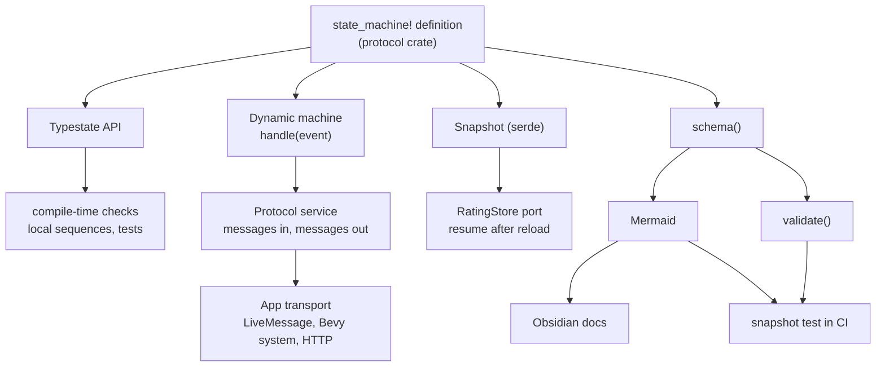
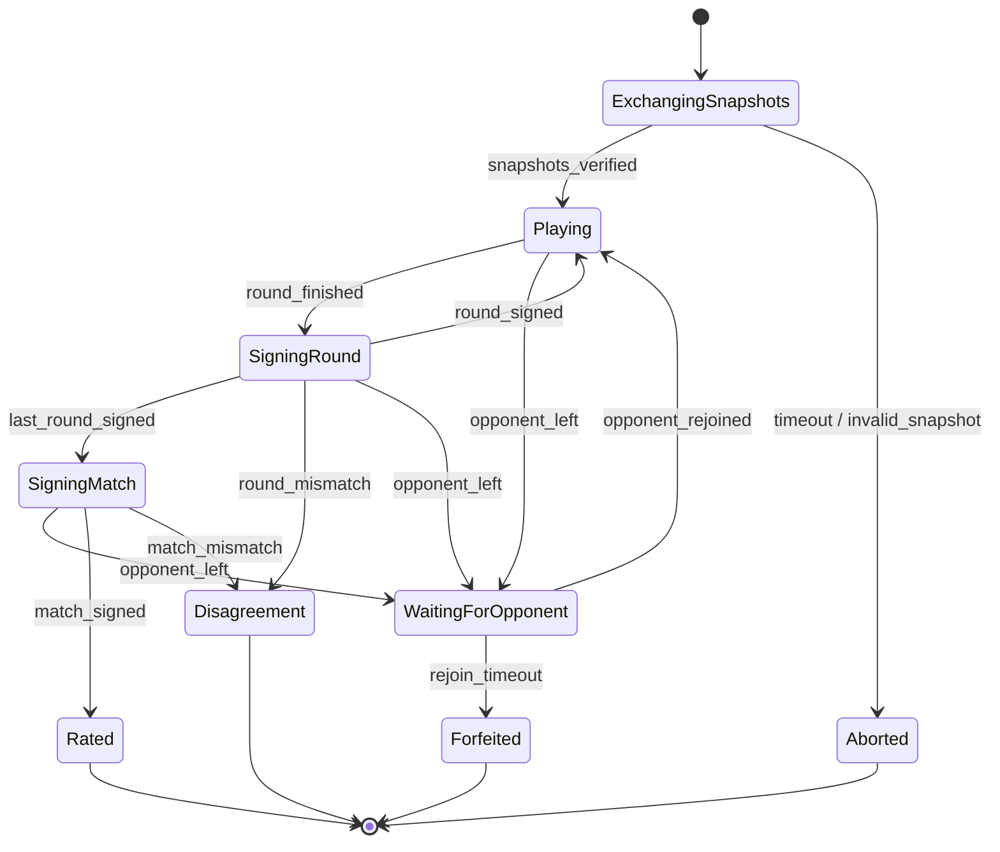
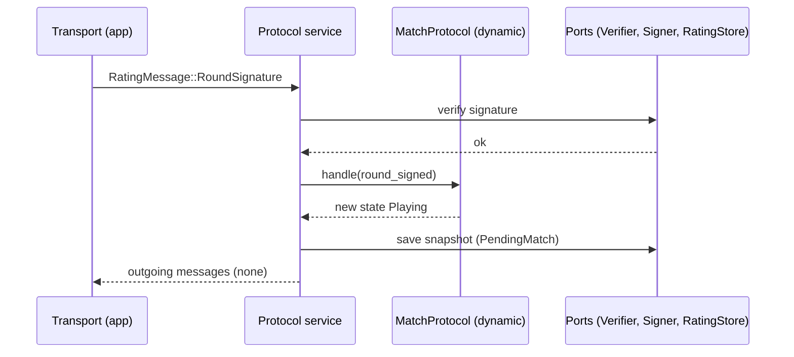
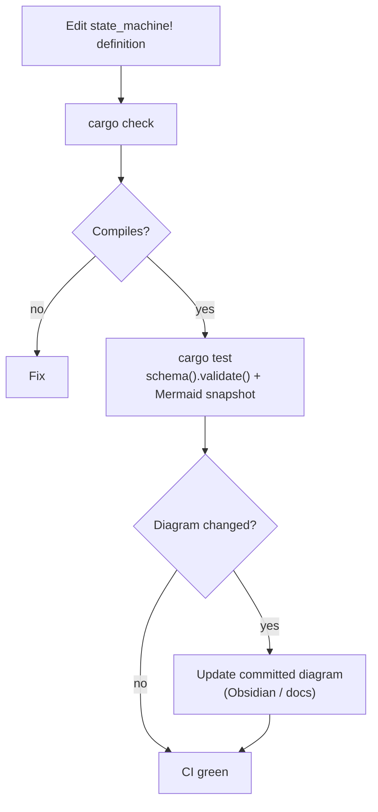

# ADR-0025: Use `state-machines` Crate for Protocols

**Status**: Accepted | **Date**: 2026-11-21

## Context

New features bring multi-step protocols between players and services:

- **Rating match protocol:** exchange signed rating snapshots, co-sign every round, co-sign the match record, handle disconnects and forfeits (see the Obsidian note *Rating Architecture*).
- **Matchmaking search:** searching → match found / no match → ghost offer → cancelled or expired.
- **Game phases** in apps (e.g. Freestyle Duel: record → play other's → play own).

These protocols must be:

- **Correct:** invalid transitions (e.g. signing a match before all rounds are co-signed) must be impossible or rejected.
- **Understandable:** the flow should be visible as a diagram.
- **In sync with docs:** diagrams in Obsidian must not drift from the code.
- **Resumable:** a browser reload in the middle of a match must be able to continue or close it out.
- **Pure:** no I/O inside the protocol (sans-IO). Messages in, messages out; transport, signing and storage stay behind ports ([[0020|ADR-0020]], [[0024|ADR-0024]]).
- **WASM-compatible.**

Hand-written enums with `match` work, but every protocol re-invents transitions, validation and docs, and the diagrams are maintained by hand.

## Decision

Use the [`state-machines`](https://docs.rs/state-machines) crate (MIT/Apache-2.0, `no_std`, Rust ≥ 1.99) to define protocol state machines with its declarative `state_machine!` macro.

The `state_machine!` definition is the **single source of truth** for implementation and documentation.

| Use | Mode | Why |
|---|---|---|
| Local, caller-driven sequences (builders, setup, tests) | **Typestate** | Invalid transitions fail at compile time |
| Network-driven protocols (peer messages, timeouts) | **Dynamic** (`dynamic: true`) | Events arrive at runtime; invalid ones are rejected with an error, not a panic |
| Persisting a running protocol (pending match across reload) | **Snapshot** (`snapshot: true`, feature `serde`) | Validated restore of state + context |
| Docs and CI | **Inspect** (`schema()`, feature `inspect`) | Generates Mermaid and JSON; `validate()` finds unreachable states and dead ends |

Rules:

- State machines live in the **protocol crates** (`konnekt-session-rating`, later `konnekt-session-matchmaking`), not in `konnekt-session-core`. Core keeps its existing activity lifecycle until there is a reason to migrate it.
- Machines are **sans-IO**: guards and callbacks only touch the machine's context. Signing, storage and sending go through ports outside the machine.
- Data that belongs to one state (e.g. received signatures during `SigningRound`) is stored as state data, not as `Option` fields on a big struct.
- Each machine has a test that renders its Mermaid diagram and compares it with the committed doc (snapshot test).

## Architecture



## Example: rating match protocol



Sketch of the definition (syntax as in the crate README; details settle during implementation):

```rust
use state_machines::state_machine;

state_machine! {
    name: MatchProtocol,
    dynamic: true,
    snapshot: true,

    initial: ExchangingSnapshots,
    states: [
        ExchangingSnapshots, Playing, SigningRound, SigningMatch,
        WaitingForOpponent, Rated, Forfeited, Disagreement, Aborted,
    ],
    events {
        snapshots_verified { transition: { from: ExchangingSnapshots, to: Playing } }
        round_finished     { transition: { from: Playing, to: SigningRound } }
        // Alternative: one `round_signed` event with `branching: true`
        // (Playing if rounds are left, else SigningMatch).
        round_signed {
            guards: [rounds_left],
            transition: { from: SigningRound, to: Playing }
        }
        last_round_signed {
            unless: [rounds_left],
            transition: { from: SigningRound, to: SigningMatch }
        }
        match_signed       { transition: { from: SigningMatch, to: Rated } }
        opponent_left {
            transition: { from: Playing, to: WaitingForOpponent }
            transition: { from: SigningRound, to: WaitingForOpponent }
            transition: { from: SigningMatch, to: WaitingForOpponent }
        }
        rejoin_timeout     { transition: { from: WaitingForOpponent, to: Forfeited } }
        // ... opponent_rejoined, round_mismatch, match_mismatch, timeout
    }
}
```

The protocol service around it maps incoming `RatingMessage`s to events, verifies signatures through the `Verifier` port **before** firing an event, and returns the messages to send.



## Alternatives Considered

| Approach | Assessment |
|---|---|
| Hand-written enum + `match` | No dependency, but transitions, validation and diagrams per protocol by hand; docs drift |
| Manual typestate | Compile-time safe, lots of boilerplate, no runtime mode for network events |
| `typestate` crate | Compile-time only, no dynamic dispatch, snapshots or diagram output |
| `statig`, `rust-fsm` | Runtime machines; no typestate + dynamic from one definition, no Mermaid from schema |
| W3C SCXML + code generation | Standardised, but extra toolchain and no typestate |
| Session types (`dialectic`, `mpstthree`) | Strong for multi-party protocols, but heavy; revisit if protocols grow beyond two peers |
| **`state-machines`** | **Chosen: declarative, typestate + dynamic, snapshots, Mermaid and validation from one definition** |

## Consequences

**Positive**

- One definition for code, diagrams and validation; Obsidian docs are generated, not drawn.
- Invalid transitions are compile errors (typestate) or explicit errors (dynamic), never silent state corruption.
- Snapshots make protocols resumable after a reload (pending matches, searches).
- Pure machines run in WASM, natively, in Cucumber tests ([[0007|ADR-0007]]) and inside Bevy resources ([[0024|ADR-0024]]).

**Negative**

- New dependency with macros; compile errors from macros can be harder to read.
- Requires Rust ≥ 1.99.
- Each peer runs its own machine. The crate does not check that two peers agree; that is still the protocol's job (canonical record bytes and co-signatures).
- Guards and callbacks must stay pure; I/O in callbacks would break sans-IO and testability.
- Typestate guarantees apply only to caller-driven code; network-driven paths rely on dynamic mode and runtime tests.

## Workflow



## See Also

- [[0020|ADR-0020]] — hexagonal ports and ACL
- [[0024|ADR-0024]] — Bevy ECS application layer
- [[0007|ADR-0007]] — Cucumber BDD tests
- [[../domain/activity|Activity]] — existing activity lifecycle (unchanged for now)
