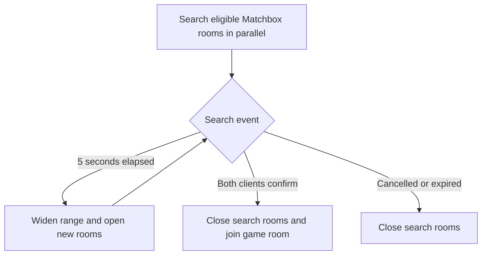

# ADR-0026: Use Client Matchmaking with Matchbox

**Status**: Accepted | **Date**: 2026-11-22

## Context

Ranked players need opponents with similar ratings, even when few players are searching.

## Options

| Option | How it works | Trade-off |
|---|---|---|
| Dedicated HTTP matchmaker | Clients submit their rating to a central queue. The service chooses pairs and assigns a Matchbox game room. | The service can compare everyone in the queue, but adds a deployment and owns queue state. |
| Sequential Matchbox search | The frontend searches one rating room at a time and switches rooms as the range widens. | Uses one discovery connection, but leaving a room can miss a nearby player who joins it later. |
| Parallel Matchbox search **(accepted)** | The frontend adds eligible rooms every 5 seconds and keeps earlier rooms open. Peers confirm the rating gap and agree on a game room. | Keeps nearby players reachable throughout the search and uses the existing backend. Each added room costs another connection. |

## Decision

Run pairing in the **frontend** and use **Matchbox** as the signaling backend. Search rooms for the same rating key in parallel. Every **5 seconds**, widen the rating window and open newly eligible rooms while keeping earlier searches active. Both clients check the actual rating gap and confirm one pair and one game room.

## Why

- Reuses the existing Matchbox deployment.
- Keeps nearby opponents reachable as the search expands.

## Trade-offs

- Clients see different candidates, so pairing is best effort.
- Wider searches open more connections. Cap the range and close connections when the search ends.

## See Also

- [[0003|ADR-0003]] — Matchbox signaling
- [[0025|ADR-0025]] — protocol state machines
