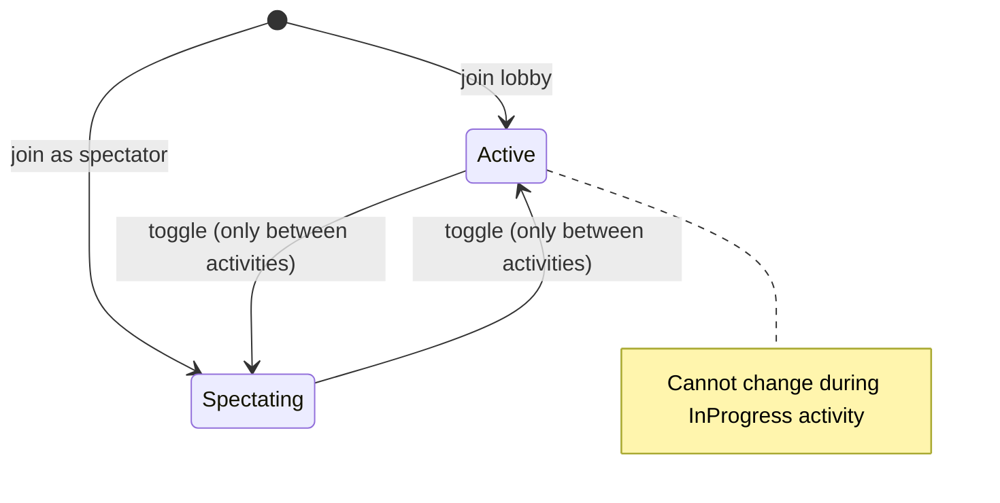

# Participation Modes

Guests can be **Active** or **Spectating**. This is independent of [[lobby-role|Lobby Role]], except that the host role is only given to active participants (see below).

## Modes

| Mode | Can Submit Results | Can Watch |
|------|-------------------|-----------|
| `Active` | Yes | Yes |
| `Spectating` | No | Yes |

## Transition Rules



A guest chooses its mode when it joins: `SessionLoopV2::join` joins as
`Active`, `join_as(name, ParticipationMode::Spectating)` joins as an observer.
See [[../protocols/join-session|Join session]].

## Interaction with Activity Completion

- Activity completes when **all Active participants** submit results.
- Spectating guests do not block completion.

## LobbyRole and ParticipationMode

```
Host   + Active      → can play AND manage
Host   + Spectating  → manages but doesn't play
Guest  + Active      → plays normally, can become host
Guest  + Spectating  → watches only, never becomes host
```

The host role is **only given to active participants**: manual delegation to a
spectator is rejected (`CannotDelegateToSpectator`), and automatic election and
failover skip spectators. A host who switches itself to Spectating stays host.
This keeps observers, who may be strangers watching a match, from ever gaining
authority over the lobby.

## See Also

- [[../domain/participant|Participant]]
- [[../domain/activity|Activity]]
- [[lobby-role|Lobby Role]]
