# Protocols

Multi-step protocols between players and services. Each protocol is a sans-IO state machine built with the `state-machines` crate ([[../adr/0025|ADR-0025]]). Its Mermaid diagram should be generated from the `state_machine!` definition once it is implemented.

| Protocol | Status | Crate | Summary |
|---|---|---|---|
| [[synchronized-start\|Synchronized start]] | partial | `konnekt-session-core` | Music retries and acknowledges count-in announcements; shared scheduling remains open |
| [[clock-probe\|Clock probe]] | partial | `konnekt-session-core` | Music live link matches and validates one outstanding probe |
| [[player-readiness\|Player readiness]] | partial | `konnekt-session-core` | Music lobby binds per-player readiness to a selection revision; shared API and ordering remain open |
| [[activity-run\|Activity run]] | partial | `konnekt-session-core` | Complete or cancel started runs; queued activities remain outside the machine |
| [[command-outcome\|Command outcome]] | partial | `konnekt-session-p2p` | Track host-local execution; guest outcomes remain planned |
| [[peer-grace\|Peer grace period]] | partial | `konnekt-session-p2p` | Track disconnect, reconnect, and timeout in the legacy peer registry |
| [[identity-verification\|Identity verification]] | partial | `konnekt-session-p2p` | Exchange peer-bound proofs; admission and authorization are not enforced |
| State synchronization | partial | `konnekt-session-p2p` | Observe initial snapshot, detected gaps, recovery, and disconnects in V2 |
| [[rating-match\|Rating Match]] | draft | `konnekt-session-rating` | Two players co-sign every round and the match record; disconnect, forfeit, resume |
| Matchmaking Search | planned | `konnekt-session-matchmaking` | Search, widening window, match found / no match / ghost offer, expiry |

V2 requests a snapshot while awaiting initial synchronization. When it detects a
sequence gap, it requests the missing range and retries while recovery is in
progress. Retries are currently based on session polls, not elapsed time. If the
host no longer has the missing messages, recovery can remain pending: snapshot
fallback is not yet safe because snapshots do not contain complete run state.
The synchronization machine does not authenticate host messages.

## Conventions

- One file per protocol: scope, inputs, messages, state machine, states, events, flows, invariants, open questions.
- Events are named after what happened (`round_finished`, `opponent_left`), not after commands.
- Guards go in square brackets in diagrams: `round_signed [last round]`.
- Actions (sign, send, store) run in the protocol service **after** a transition, never inside the machine.

<!-- generated-protocol-diagrams:start -->
## Generated state machines

Run `just protocol-diagrams` to update these diagrams.

### Asset transfer

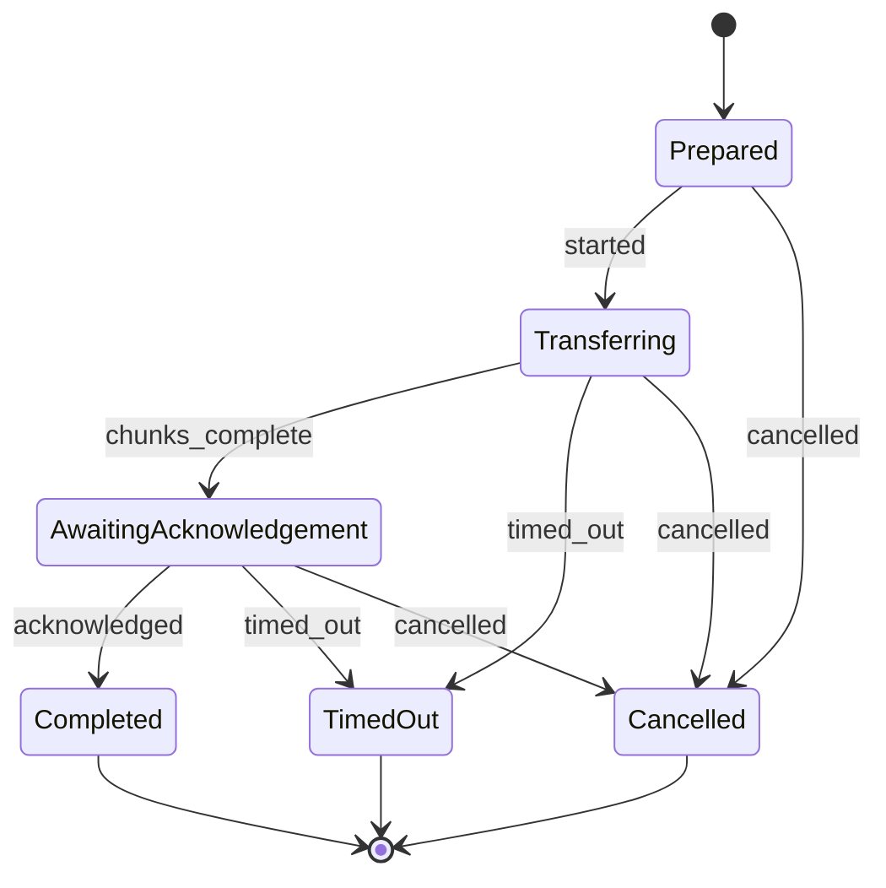

### Synchronized start

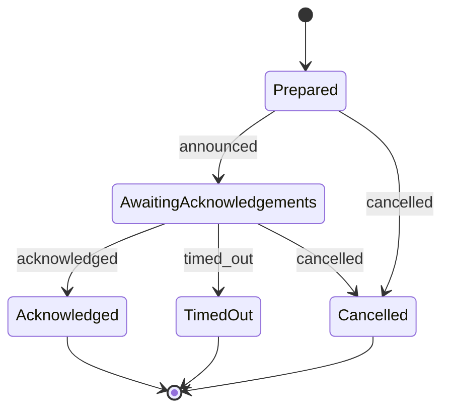

### Clock probe

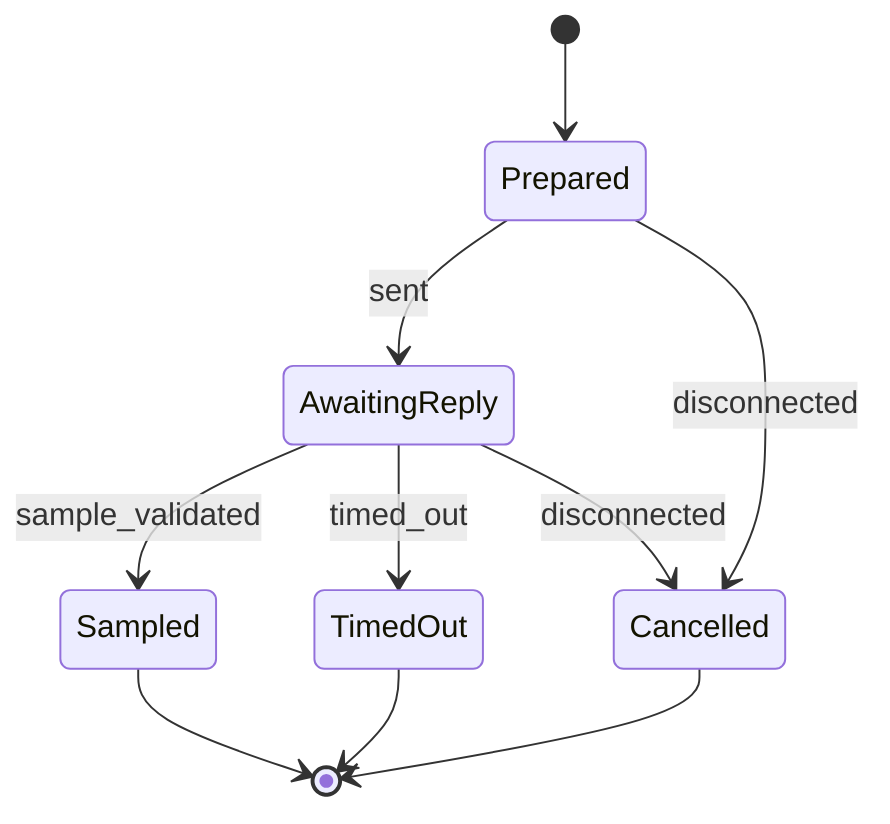

### Player readiness

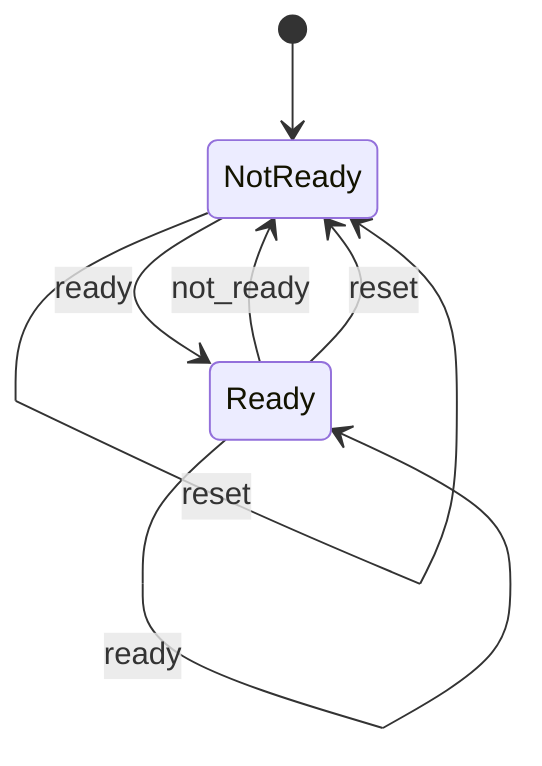

### Activity run

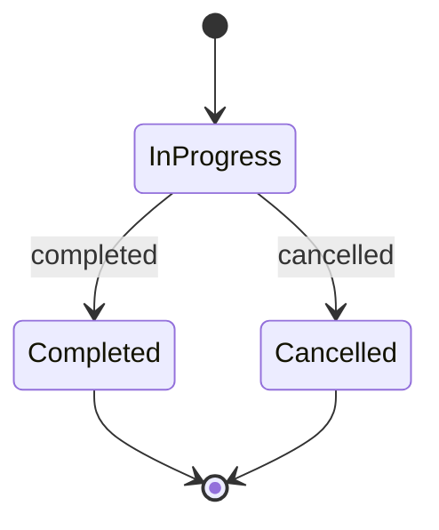

### Command outcome

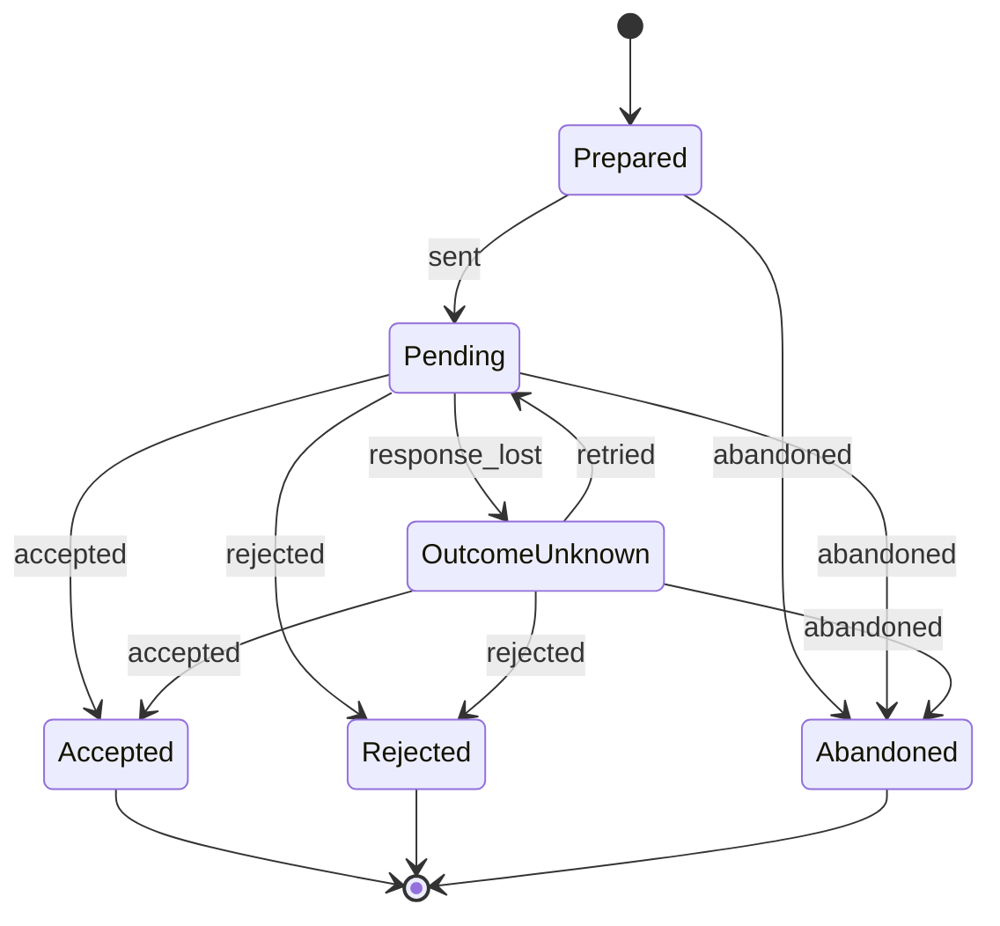

### Request execution

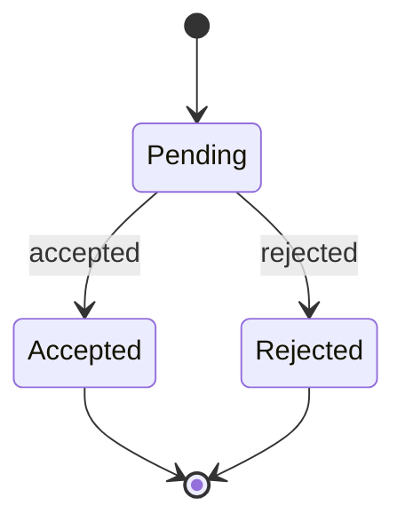

### Identity verification

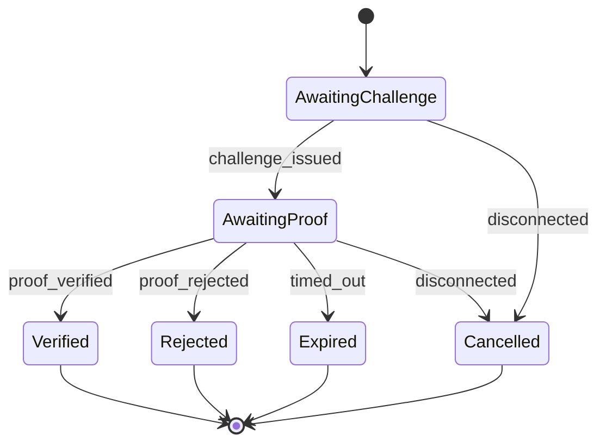

### Peer grace period

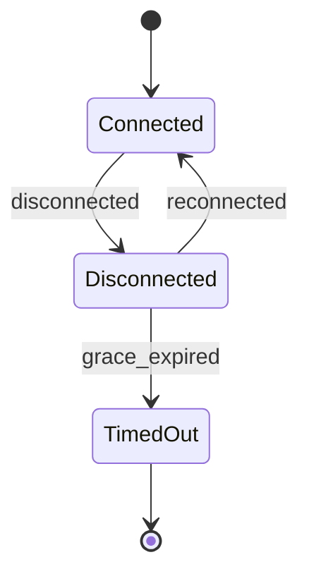

### Join session

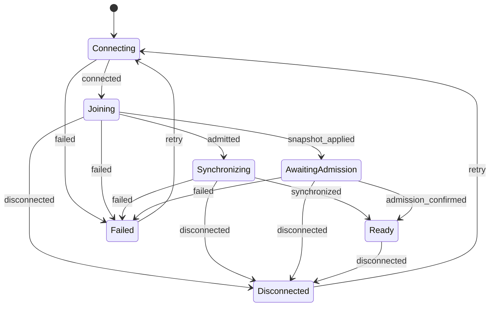

### State synchronization

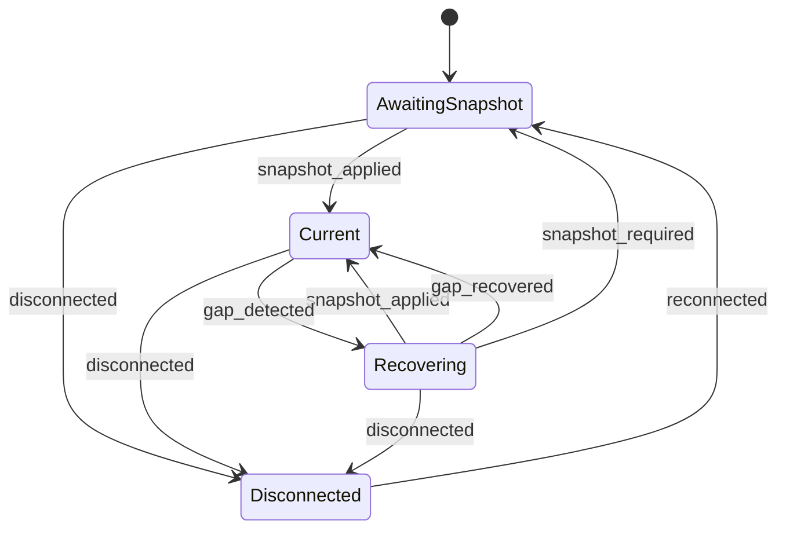

### Rating match

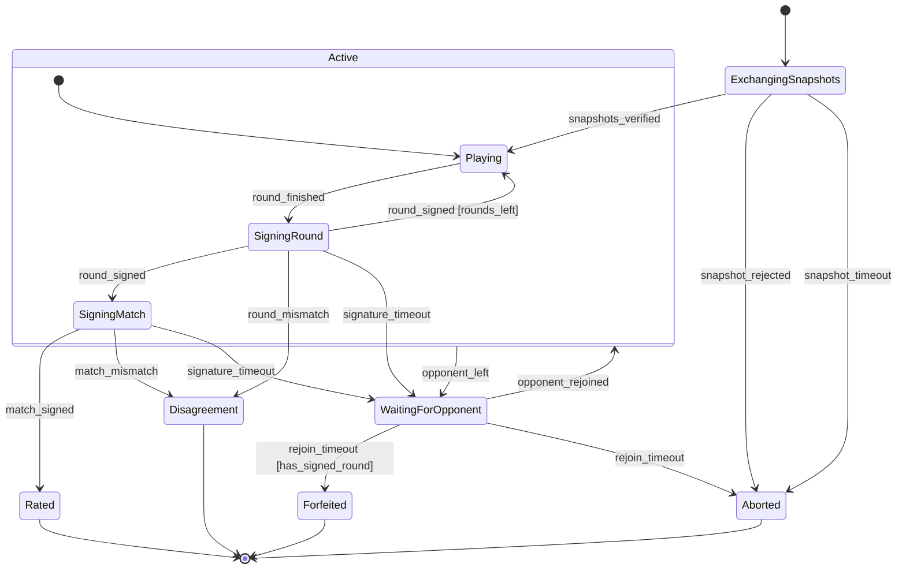
<!-- generated-protocol-diagrams:end -->
