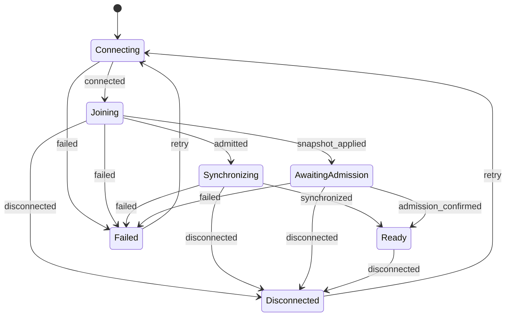
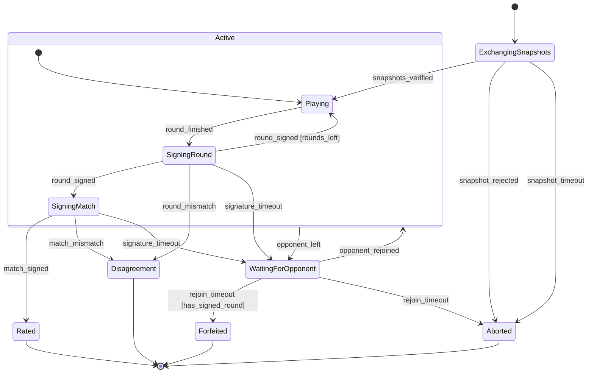

# Protocols

Multi-step protocols between players and services. Each protocol is a sans-IO state machine built with the `state-machines` crate ([[../adr/0025|ADR-0025]]). Its Mermaid diagram should be generated from the `state_machine!` definition once it is implemented.

| Protocol | Status | Crate | Summary |
|---|---|---|---|
| [[rating-match\|Rating Match]] | draft | `konnekt-session-rating` | Two players co-sign every round and the match record; disconnect, forfeit, resume |
| Matchmaking Search | planned | `konnekt-session-matchmaking` | Search, widening window, match found / no match / ghost offer, expiry |

## Conventions

- One file per protocol: scope, inputs, messages, state machine, states, events, flows, invariants, open questions.
- Events are named after what happened (`round_finished`, `opponent_left`), not after commands.
- Guards go in square brackets in diagrams: `round_signed [last round]`.
- Actions (sign, send, store) run in the protocol service **after** a transition, never inside the machine.

<!-- generated-protocol-diagrams:start -->
## Generated state machines

Run `just protocol-diagrams` to update these diagrams.

### Join session

### Rating match

<!-- generated-protocol-diagrams:end -->
