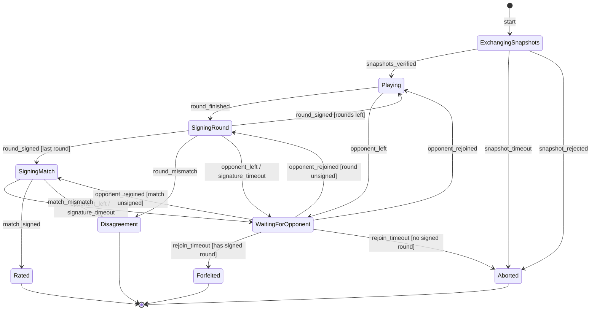
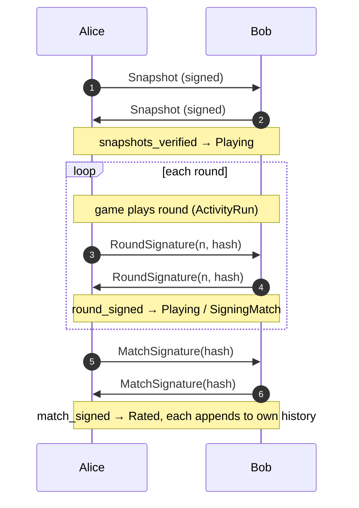
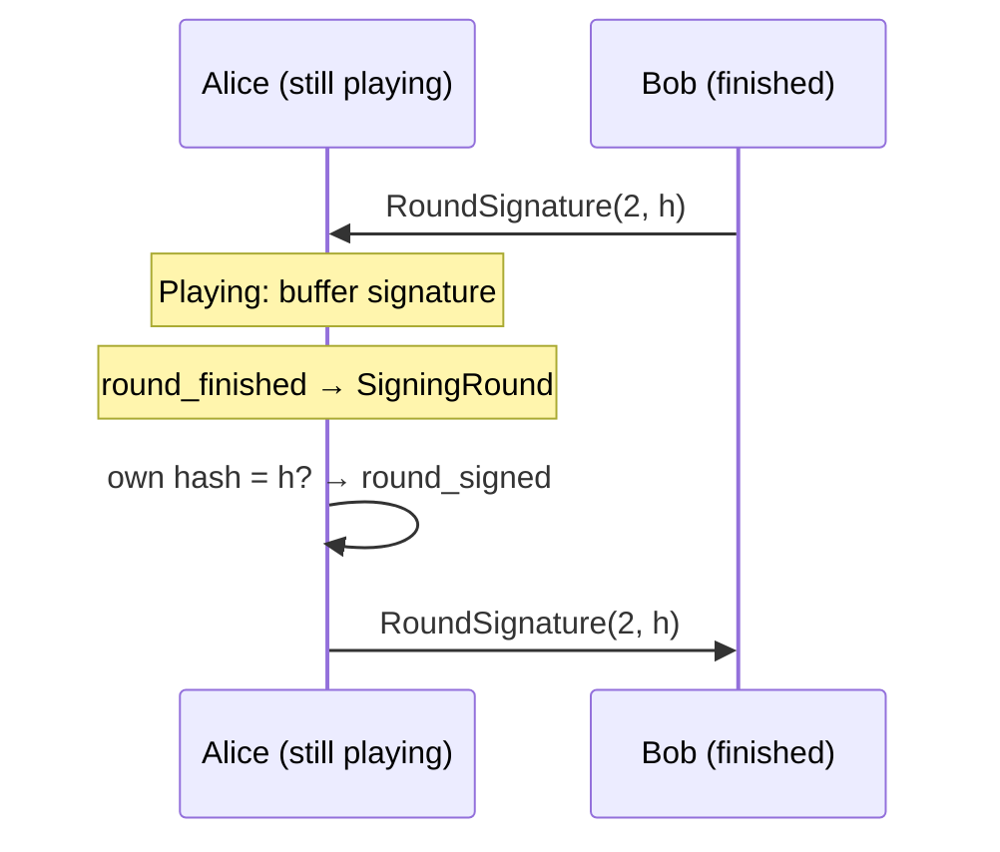
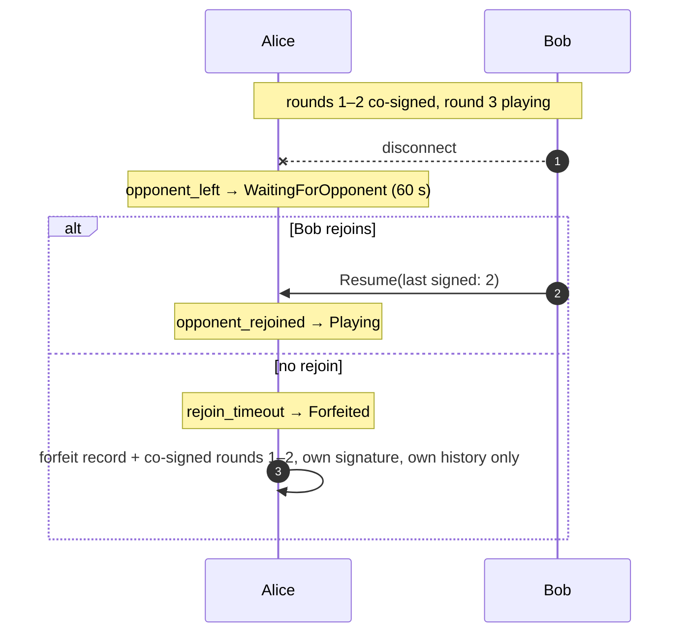
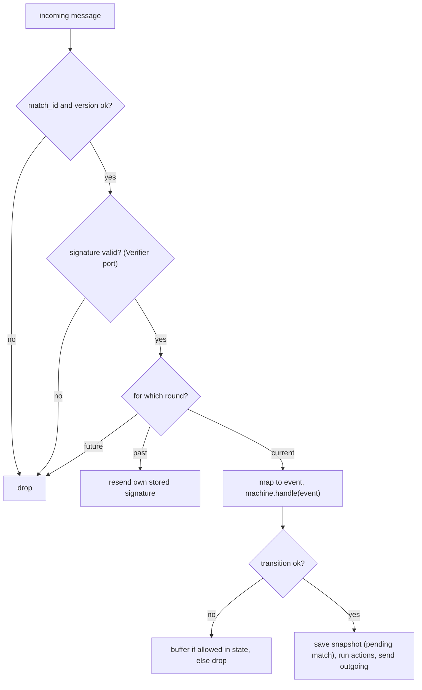

# Rating Match Protocol

Two players agree on a rated match result **without a server**. Each player runs the **same state machine** on their own client. Signed messages are exchanged over the app's live channel. Every round is co-signed as soon as it ends, and the match record at the end is co-signed too. Each player stores only their own history.

Implemented with the `state-machines` crate in dynamic mode with snapshots ([[../adr/0025|ADR-0025]]). Signing, storage and transport are ports. The machine itself does no I/O.

## Scope

| In | Out |
|---|---|
| 2 players, 1..n rounds, one `RatingKey` | More than 2 players (later) |
| Signed rating snapshots, round and match co-signatures | How a round is played (the game, `ActivityRun`) |
| Disconnect, rejoin, forfeit, disagreement | Matchmaking (separate protocol) |
| Resume after browser reload | Server verification (later) |

## Inputs from the game

The game starts the protocol with:

| Input | Example (Freestyle Duel) |
|---|---|
| `match_id` | Room ID from matchmaking, or generated by the host |
| `rating_key` | `music.freestyle-duel.v1` |
| `players` | both `ParticipantId`s |
| `rounds` | 3 (record, play other's, play own) |
| `weight` | 1.0 (0.25 for ghost games, which skip this protocol, see below) |

For each finished round, the game supplies a **`RoundResult`**: evidence hash and scores. At the end it supplies a **`Placement`** (from `RatedGame::placement`). Both clients must compute these **from the same data**, i.e. the synced `ActivityRun` results.

## Messages

All messages carry `match_id` and the protocol version. Every signature covers **canonical bytes with a domain separator**.

| Message | Content | Domain separator |
|---|---|---|
| `Snapshot` | `Signed<RatingSnapshot>`: player, key, rating state, games, `seq`, `head` | `konnekt-rating/snapshot/v1` |
| `RoundSignature` | round number, `RoundRecord` hash, signature | `konnekt-rating/round/v1` |
| `MatchSignature` | `MatchRecord` hash, signature | `konnekt-rating/match/v1` |
| `Resume` | last round I hold co-signed, my match-signature state | — (requests missing signatures) |
| `Abort` | reason | — (informational, never trusted for rating) |

`RoundRecord { match_id, round, prev_round, evidence, scores }`. Each round links to the previous one by hash.
`MatchRecord { match_id, key, players, before, rounds_head, placement, weight, outcome, seq, prev, witness }`, see *Rating Architecture* (Obsidian).

## State machine

### States

| State | State data | Meaning |
|---|---|---|
| `ExchangingSnapshots` | own snapshot, opponent snapshot (once received) | Both sides learn each other's rating before the match |
| `Playing` | current round, early opponent signature (buffered) | A round is being played by the game |
| `SigningRound` | own `RoundRecord` + signature, opponent signature | Waiting until both signatures for this round exist |
| `SigningMatch` | own `MatchRecord` + signature, opponent signature | Waiting for the match co-signature |
| `WaitingForOpponent` | state to return to, deadline | Opponent disconnected or stopped signing |
| `Rated` | appended record | Final: both signed, own history updated |
| `Forfeited` | forfeit record (own signature + co-signed rounds) | Final: opponent gone, local-only record |
| `Disagreement` | both conflicting hashes | Final: not rated |
| `Aborted` | reason | Final: not rated |

Context (in all states): `match_id`, `rating_key`, players, round count, co-signed rounds so far, both snapshots.

### Events

| Event | From → To | Guard | Action (outside the machine, by the protocol service) |
|---|---|---|---|
| `start` | — → `ExchangingSnapshots` | — | sign and send own `Snapshot`; save pending match |
| `snapshots_verified` | `ExchangingSnapshots` → `Playing` | opponent signature valid, key matches, last-seen check passes | save pending match |
| `snapshot_rejected` | `ExchangingSnapshots` → `Aborted` | signature invalid, wrong key, rewind/fork detected | send `Abort` |
| `snapshot_timeout` | `ExchangingSnapshots` → `Aborted` | 30 s | send `Abort` |
| `round_finished` | `Playing` → `SigningRound` | — | build `RoundRecord`, sign, send `RoundSignature` |
| `round_signed` | `SigningRound` → `Playing` / `SigningMatch` | opponent hash = own hash; rounds left or not | store co-signed round; on last round build + sign + send `MatchRecord` |
| `round_mismatch` | `SigningRound` → `Disagreement` | opponent hash ≠ own hash | send `Abort` |
| `match_signed` | `SigningMatch` → `Rated` | opponent hash = own hash, append succeeded | append to history (compare head), update last seen, delete pending match |
| `match_mismatch` | `SigningMatch` → `Disagreement` | opponent hash ≠ own hash | send `Abort` |
| `opponent_left` | `Playing` / `SigningRound` / `SigningMatch` → `WaitingForOpponent` | transport reports disconnect | start rejoin deadline |
| `signature_timeout` | `SigningRound` / `SigningMatch` → `WaitingForOpponent` | 30 s without the opponent's signature | start rejoin deadline |
| `opponent_rejoined` | `WaitingForOpponent` → previous state | `Resume` received | send missing signatures |
| `rejoin_timeout` | `WaitingForOpponent` → `Forfeited` / `Aborted` | 60 s; at least one co-signed round → `Forfeited` | write forfeit record, own signature only |

Timeouts are proposals; they come from config, not constants.

## Flows

### Happy path

### Signatures arriving early
The two clients don't finish a round at exactly the same moment. A `RoundSignature` for the current round that arrives in `Playing` is **buffered** in the state data, not rejected. When `round_finished` fires, the buffered signature is checked right away.

Rule: messages for the **current** round or match are buffered. Messages for **past** rounds are answered from the stored co-signed rounds, which is the resend case. Messages for **future** rounds are dropped.

### Disconnect and rejoin

### Message handling (protocol service)

Invalid messages are never errors that end the match. They are dropped, so a broken or malicious peer can't push the other side into a bad state. Only timeouts and hash mismatches end a match without a rating.

## Resume after reload

- After every transition, the protocol service saves the machine snapshot (`into_snapshot()`) as a **pending match** through the `RatingStore` port.
- On app start, pending matches are restored (`from_snapshot()`). A restored match in a non-final state sends `Resume` and fires `opponent_left`, which starts the rejoin deadline.
- Final states delete the pending match after their action is done.

## Invariants

- A round counts only with **both** signatures over **identical** bytes.
- The match record counts only with both signatures. The only exception is `Forfeited`, which is explicitly marked and local only.
- The rating is changed only in `Rated` and `Forfeited`, and only in the player's **own** history.
- Each client signs **at most one** record per `(match_id, round)` and one match record per `match_id`. Signing two different ones is equivocation and provable.
- The machine never performs I/O. Every action is run by the protocol service after a successful transition.

## Not covered by this protocol

- **Ghost games** have no live opponent. The client writes a record with weight 0.25 and its own signature only, plus a reference to the ghost's signed sheet. That needs no co-signing protocol.
- A **disagreement** has no resolution step. The match is simply not rated.
- **Server upload** of forfeit records (so the leaver also gets the loss) comes later.

## Open questions

- [ ] Timeout values: 30 s snapshot, 30 s signature, 60 s rejoin?
- [ ] Forfeit: count as a full win, a reduced weight, or only a mark? Is one co-signed round enough?
- [ ] `match_id`: from matchmaking or the host, or derived from the two snapshot hashes?
- [ ] If the local append fails (the head changed in another tab), `Rated` is never reached, but the opponent may already have rated. Retry with a fresh head, or abort?

## See Also

- [[../adr/0025|ADR-0025]] — state machines for protocols
- [[../domain/activity-run|ActivityRun]] — rounds are played as runs
- [[../concepts/p2p-signing|P2P Signing]] — Ed25519 in the lobby
- [[index|Protocols]]
